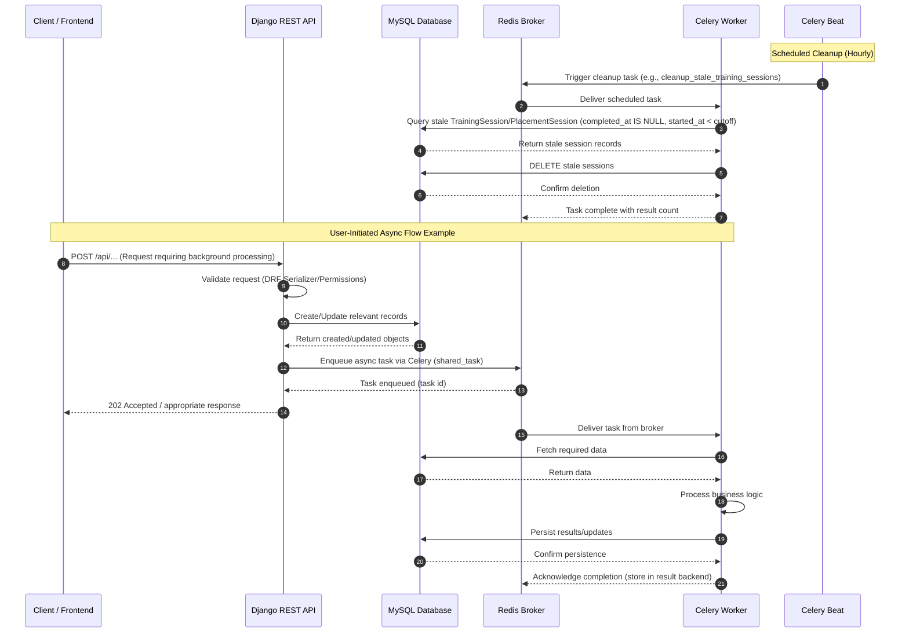
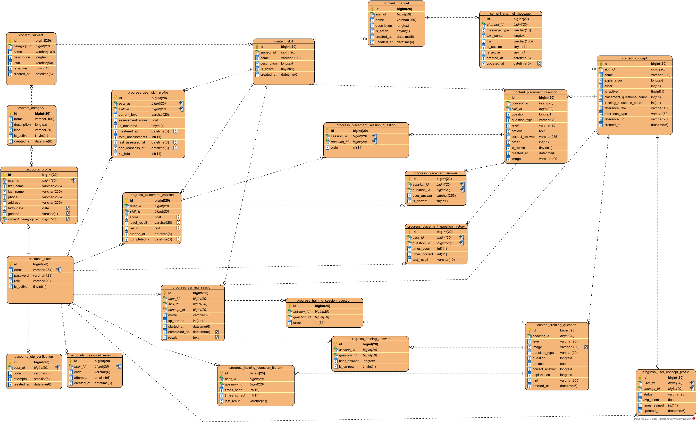

# Virtual Mentor 🎓

## Overview 📚

Virtual Mentor is a Django REST Framework-based learning platform that provides personalized, adaptive learning experiences for students. The system combines placement assessments, adaptive training modules, and a virtual mentoring environment to guide students through their learning journey. The platform supports multiple user roles (students, editors, and admins), content management, progress tracking, and asynchronous task processing for background operations.

## Functional Features ✨

Based on the actual implementation:

### Account Management 👤
- **User Registration & Authentication**: Email-based registration with OTP verification. Users are created as inactive until verified via OTP.
- **JWT Authentication**: Secure token-based authentication using `djangorestframework-simplejwt` with token rotation and blacklisting.
- **Role-Based Access Control**: Three user roles - Student, Editor, and Admin with different permissions.
- **Profile Management**: Student profiles with personal information (name, phone, address, birth date, gender) and linked to a current category.
- **Password Management**: Password reset functionality via OTP verification.
- **Email Notifications**: Account-related emails via Gmail SMTP.
- **Firebase Integration**: Firebase credentials configured for potential push notifications/features.

### Content Management 📑
- **Hierarchical Structure**: Categories → Subjects → Skills → Concepts with images/icons support.
- **Content Administration**: Editors and admins can manage learning content through the API.
- **Channel System**: Skills can have communication channels with text, audio, and image messages for learning materials/sections.
- **Flexible Question Types**: Support for multiple choice, true/false, fill-in-the-blank, and ordering questions.

### Placement Assessment 🧪
- **Adaptive Placement Tests**: Skills have configurable placement tests (default: 3 concepts, 18 total questions).
- **Question Selection**: Placement questions are selected based on concepts and distributed across difficulty levels (beginner, intermediate, advanced).
- **Scoring & Level Assignment**: After completing placement tests, students are assigned an initial skill level (beginner/intermediate/advanced).
- **Progress Tracking**: Placement history is tracked per user and per question to avoid repetition.

### Training System 🧠
- **Personalized Training**: Students train on specific concepts within skills, with difficulty levels tailored to their progress.
- **Configurable Question Counts**: Each skill defines question distribution (beginner/intermediate/advanced) for training sessions (defaults: 3 beginner, 4 intermediate, 3 advanced).
- **Session Modes**: Training sessions support both automatic and manual modes.
- **Answer Validation**: Immediate feedback with explanations shown after answering, and hints available on request.
- **XP System**: Students earn XP for completing training sessions.
- **Question History**: Training question history tracks attempts and success rates per user.

### Progress Tracking 📈
- **User Skill Profiles**: Track current level, assessment scores, mastery status, total assessments, XP, and reassessment availability per skill.
- **User Concept Profiles**: Track learning status (not started/in progress/completed/mastered), average scores, and training frequency per concept.
- **Mastery Detection**: Skills can be marked as mastered with timestamps.
- **Reassessment Logic**: Cooldown periods between reassessments via `can_reassess_at`.

### Background Processing (Celery) ⚙️
- **Automated Cleanup**: Periodic tasks to delete unactivated users after 24 hours and remove stale sessions (both training and placement) older than configured threshold.
- **Scheduled Tasks**: Celery Beat runs cleanup jobs hourly.

### Progress Service Layer 🧩
- **Separation of Business Logic**: The `progress` app uses a dedicated `services/` layer to keep views thin and logic reusable.
- **Placement Service (`services/placement.py`)**: Handles placement session creation, question selection across concepts/levels, answer grading, result calculation, XP/level assignment, mastery updates, and progress resets.
- **Training Service (`services/training.py`)**: Manages adaptive training sessions (auto/manual), answer validation, XP awarding, concept/skill profile updates, and mastery detection.
- **Statistics Service (`services/stats.py`)**: Aggregates user progress per category/subject/skill for dashboard views with optimized batched queries.
- **Shared Helpers (`services/common.py`)**: Provides Arabic-aware answer normalization (diacritics/tashkeel, "ال", spacing), scoring helpers, level derivation, and concept ordering logic.

### Automated Testing 🧪
- **Progress Tests (`progress/tests/`)**: Comprehensive test suite covering answer normalization, placement flow, training flow, and query/statistics logic to ensure correct grading, adaptive behavior, and profile updates.
- **Test Structure**: Includes `conftest.py` (fixtures), `_factories.py` (test data builders), `test_answers.py` (Arabic-aware normalization and scoring helpers), `test_placement.py` (placement session logic, boundaries, smoothing, mastery), `test_training.py` (training sessions and concept profile updates), and `test_queries.py` (N+1 query regression guards).

## Tech Stack 🛠️

### Backend Framework 🧩
- **Django 6.0.3** - Core web framework
- **Django REST Framework 3.16.1** - API development
- **djoser 2.3.3** - Authentication endpoints
- **drf-nested-routers 0.95.0** - Nested routing

### Authentication & Security 🔐
- **djangorestframework-simplejwt 5.5.1** - JWT authentication with token rotation and blacklisting
- **django-cors-headers 4.9.0** - CORS handling
- **django-ratelimit 4.1.0** - Rate limiting

### Database 💾
- **MySQL** (via `mysqlclient` 2.2.8 / PyMySQL) - Primary relational database

### Caching & Task Queue ⚡
- **Redis 7 (Alpine)** - Message broker and result backend for Celery
- **Celery 5.6.3** - Asynchronous task processing
- **django-celery-beat / celery beat** - Periodic task scheduling

### Additional Services 🔌
- **Firebase Admin SDK 7.3.0** - Firebase integration
- **Pillow 12.1.1** - Image processing
- **Gunicorn 25.1.0** - WSGI HTTP Server
- **django-filter, django-extensions** - Utilities


## Sequence Diagram 🔄



## ERD Diagram 🗂️



## Installation & Setup 🚀

### Prerequisites 📋
- Docker and Docker Compose
- Git

### Environment Configuration ⚙️
Create a `.env` file in the project root with the following variables (based on `settings.py` and `docker-compose.yml`):

```env
# Django
SECRET_KEY=your_secret_key
DEBUG=False
ALLOWED_HOSTS=localhost,127.0.0.1
CSRF_TRUSTED_ORIGINS=http://localhost:8000

# Database
DB_NAME=virtual_mentor_db
DB_USER=your_db_user
DB_PASSWORD=your_db_password
DB_ROOT_PASSWORD=your_db_root_password
DB_HOST=db
DB_PORT=3306

# Email (Gmail SMTP)
EMAIL_HOST_USER=your_email@gmail.com
EMAIL_HOST_PASSWORD=your_app_password
DEFAULT_FROM_EMAIL=your_email@gmail.com

# Celery
CELERY_BROKER_URL=redis://redis:6379/0
CELERY_RESULT_BACKEND=redis://redis:6379/0
```

### Running with Docker Compose

1. **Clone the repository**:
```bash
git clone <repository-url>
cd App
```

2. **Build and start all services**:
```bash
docker compose up --build
```

This will start the following containers:
- `mysql_db` (MySQL 8.0) - Port 3306
- `redis_cache` (Redis 7 Alpine) - Port 6379
- `django_api` (Django API) - Port 8000
- `celery_worker` (Celery worker)
- `celery_beat` (Celery beat scheduler)

3. **Run database migrations** (in a separate terminal if needed):
```bash
docker compose exec api python manage.py migrate
```

4. **Create a superuser**:
```bash
docker compose exec api python manage.py createsuperuser
```

5. **Access the application**:
- API: `http://localhost:8000`
- Admin Panel: `http://localhost:8000/admin/`
- Health Check: `http://localhost:8000/health/`

### Stopping the services
```bash
docker compose down
```

To remove volumes as well (this will delete all data):
```bash
docker compose down -v
```

## Running Tests Locally 🧪

You can run the test suite locally using pytest (as configured in `pytest.ini`).

### Prerequisites
- Python environment set up with dependencies from `requirements.txt`
- Database and environment variables configured as needed

### Commands

```bash
# Run all tests
pytest

# Run tests for a specific app
pytest accounts/
pytest content/
pytest progress/

# Run with verbose output
pytest -v

# Run a specific test file
pytest progress/tests/test_placement.py
```

## API Documentation 📘

- **Postman Documentation**: [Virtual Mentor API Documentation](https://documenter.getpostman.com/view/49628421/2sBXijKXVP)

